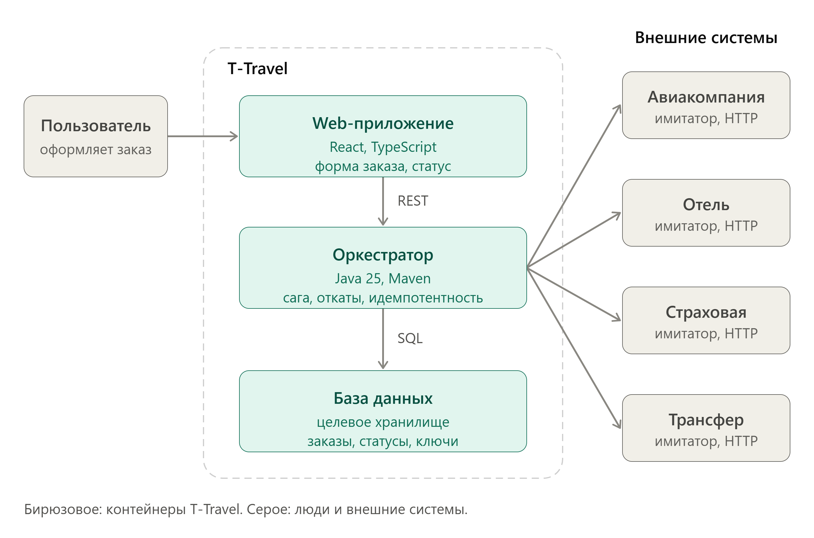

# Обзор системы T-Travel

## Назначение

Система должна позволять пользователю собрать поездку из отдельных услуг: перелёта, проживания, страховки и трансфера. Оркестратор принимает выбор, создаёт заказ и координирует операции у независимых поставщиков. Поскольку бронирования нельзя надёжно объединить в одну атомарную транзакцию, целевая модель использует длительный процесс с идемпотентностью, повторами и компенсацией уже выполненных операций.

## Целевая архитектура

| Часть | Ответственность по спецификации
|---|---|
| Web | Поиск услуг, создание/просмотр заказов и получение обновлений.
| Оркестратор | API заказов и предложений; координация бронирований, журнал событий, уведомления и восстановление после ошибок.
| Поставщики | Поиск и резервирование услуг, подтверждение и отмена брони. 
| Хранилище | Состояния заказов и компонентов, попытки обращений, события и уведомления.

## Жизненный цикл заказа

## Надёжность и данные

## HTTP API

Подробные поля запросов и ответов, коды ошибок и примеры приведены в [контракте endpoints](../contracts/endpoints.md). Основные группы:

| Ресурс | Назначение |
|---|---|
| `/offers` | Получение предложений поставщиков. |
| `/orders` | Создание, отправка на подтверждение, просмотр, список и отмена заказов. |
| `/orders/{id}/events` | История событий заказа. |
| `/orders/{id}/stream` | Обновления заказа через Server-Sent Events. |
| `/orders/{id}/components/{componentId}/attempts` | История обращений к поставщику для компонента. |
| `/notifications` | Список уведомлений и отметка о прочтении. |
| `/{supplier}/...` | Поиск, резервирование, подтверждение, проверка и отмена брони у поставщика. |
| `/sim/faults/{supplier}` | Управление режимами ошибок имитатора поставщика. |

## Имитаторы отказов

## Запуск и проверки

Единственная запускаемая часть сейчас — web. Из каталога `web/` выполните `npm ci`, затем `npm run dev`. Перед отправкой изменений web проверяйте `npm run build` и `npm run lint`. Backend-команд сборки пока нет, так как Maven-проекты не настроены.

## Документы

- [Контракт HTTP API](../contracts/endpoints.md)
- [Диаграмма состояний заказа](../app/docs/state_machine.md)
- [Правила коммитов](../COMMITS.md)