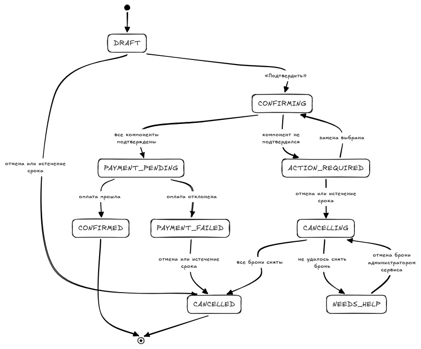

# Сценарий пользователя: поэтапное бронирование поездки

Документ описывает, как работает оркестратор составного бронирования с точки зрения пользователя и как каждый шаг ложится на сервисы. Статусы и переходы согласованы со схемой состояний заказа.

## 1. Краткое описание

Пользователь собирает поездку по страницам: перелёт, гостиница, страховка, трансфер, итоговый экран.

На каждой странице он выбирает предложение, и оркестратор сразу бронирует его у поставщика. Если предложение недоступно, пользователь узнаёт об этом сразу и остаётся на той же странице.

На итоговом экране пользователь нажимает «Подтвердить», и оркестратор по очереди подтверждает все удержанные брони. Когда все компоненты подтверждены, заказ переходит к оплате.

Если какой-то компонент не подтвердился, пользователя возвращают на страницу этого компонента, чтобы выбрать замену. Уже подтверждённые компоненты не трогаются.

Если пользователь отказывается от поездки или истекает срок, оркестратор отменяет всё сделанное.

## 2. Страницы и что происходит в оркестраторе

Шаг 0, старт: пользователь открыл конструктор, оркестратор создаёт заказ DRAFT с ключом идемпотентности.

Шаг 1, перелёт: пользователь выбрал рейс и нажал «Далее», вызывается selectOffer(FLIGHT).

Шаг 2, гостиница: selectOffer(HOTEL).

Шаг 3, страховка: selectOffer(INSURANCE).

Шаг 4, трансфер: selectOffer(TRANSFER).

Шаг 5: пользователь указывает данные о пассажирах.

Шаг 6: пользователь проверил состав и нажал «Подтвердить», оркестратор подтверждает все брони, затем проводит оплату.

Кнопка «Назад» допустима на любом шаге: если пользователь выбрал другое предложение, прежняя бронь отменяется у поставщика, а новая создаётся.

Порядок страниц задаёт stepNo компонента: перелёт 1, гостиница 2, страховка 3, трансфер 4. Страховка не зависит от перелёта и гостиницы: это отдельный фиксированный шаг, выбор или замена перелёта и отеля её не меняют.

## 3. Статусы заказа

DRAFT: идёт сборка поездки.

CONFIRMING: пользователь нажал «Подтвердить», идёт подтверждение компонентов, показываем прогресс.

ACTION_REQUIRED: нужно действие, заменить компонент или отменить поездку.

PAYMENT_PENDING: все компоненты подтверждены, проверяем оплату.

PAYMENT_FAILED: оплата отклонена. Остаётся только отмена поездки, вручную или по истечении срока.

CONFIRMED: оплата прошла, поездка оформлена. Финальный статус.

CANCELLING: отменяем поездку, снимаем брони.

NEEDS_HELP: не удалось снять бронь, нужна помощь администратора сервиса. После того как администратор отменил бронь, заказ возвращается в CANCELLING.

CANCELLED: отменено, брони сняты, деньги не списаны. Финальный статус.

Правило «актуальный компонент». При замене старый компонент остаётся в базе для истории (журнал и попытки сохраняются), а новый создаётся отдельной строкой. Актуальным считается компонент типа с наибольшим id. Итоговая цена считается только по актуальным компонентам. Компонент «требует внимания», если актуальный в FAILED или CANCELLED.

## 4. Таблица переходов OrderStateMachine

## 5. Основной сценарий

Старт. Web генерирует Idempotency-Key (случайный UUID) и отправляет POST /orders с этим заголовком. Ключ создаётся один раз при открытии конструктора и хранится, пока заказ не завершён, чтобы обновление страницы не создавало второй заказ.

Сервис заказа оркестратора:

1. ищет заказ по паре (userId, idempotency_key);
2. если заказ найден, возвращает его же в текущем состоянии (повтор, раздел 8);
3. если нет, создаёт TripOrder в статусе DRAFT с idempotency_key;
4. пишет событие DRAFT через EventService и возвращает CreateOrderResult (заказ и признак «создан»).

Выбор предложения на странице повторяется для каждого шага. Web отправляет PUT /orders/{id}/components/{type} с offerId. Сервис:

1. проверяет, что заказ в DRAFT или ACTION_REQUIRED;
2. если у этого типа уже есть актуальный компонент в RESERVED, отменяет его у поставщика (COMPENSATING → CANCELLED);
3. получает предложение, фиксирует цену и снимок;
4. создаёт новый OrderComponent в PENDING с нужным stepNo;
5. вызывает ComponentProcessor.reserve (синхронно, пользователь ждёт на странице): статус RESERVING, запись в ComponentAttempt, вызов SupplierClient.reserve с ключом {orderId}:{componentId}:RESERVE;
6. при успехе сохраняет externalBookingId, ставит deadlineAt (срок удержания, 15 минут), статус RESERVED, пересчитывает total_price;
7. записывает событие COMPONENT_RESERVED и возвращает OrderView.

Итоговый экран. Web показывает состав заказа, цену и таймер до deadlineAt. Пользователь нажимает «Подтвердить»: POST /orders/{id}/submit.

Подтверждение:

1. проверяет, что заказ в DRAFT или ACTION_REQUIRED и что все выбранные компоненты в RESERVED (иначе 409 ORDER_NOT_READY);
2. через OrderTransitionService переводит заказ в CONFIRMING;
3. запускает BookingService.run(orderId) в фоне и сразу отвечает 202.

BookingService.run в фоне:

1. берёт актуальные компоненты в порядке stepNo, уже CONFIRMED пропускает;
2. для каждого RESERVED последовательно вызывает ComponentProcessor.confirm: запись попытки, SupplierClient.confirm, статус CONFIRMED, событие COMPONENT_CONFIRMED;
3. когда все компоненты CONFIRMED, заказ переходит в PAYMENT_PENDING и запускается оплата;
4. оплата прошла: заказ CONFIRMED, уведомление «Поездка оформлена»;
5. оплата отклонена: заказ PAYMENT_FAILED, пользователь может только отменить поездку.

Пока это идёт, web открывает GET /orders/{id}/stream (SSE) и показывает прогресс по компонентам. Итог читается через GET /orders/{id}.

## 6. Сценарий: компонент не подтвердился

Пример: гостиница отказала при подтверждении, перелёт уже подтверждён.

1. BookingService.run подтвердил перелёт (CONFIRMED), на гостинице SupplierClient.confirm вернул отказ.
2. ComponentProcessor.confirm отменяет бронь гостиницы у поставщика, компонент RESERVED → COMPENSATING → CANCELLED, причина пишется в ComponentAttempt.error, событие COMPONENT_CONFIRM_FAILED.
3. BookingService останавливается на первой ошибке: страховка и трансфер остаются RESERVED и продолжают удерживаться.
4. Заказ CONFIRMING → ACTION_REQUIRED, failure_reason = «Гостиница недоступна», уведомление пользователю.
5. Web получает событие по SSE и видит в OrderView поле actionRequiredFor = HOTEL. Он открывает страницу гостиницы с сообщением об ошибке.

Дальше пользователь выбирает одно из двух.

а) Выбрать замену. PUT /orders/{id}/components/HOTEL с новым offerId: новый компонент бронируется, как на обычном шаге. Затем «Подтвердить» на итоговом экране: заказ ACTION_REQUIRED → CONFIRMING, BookingService.run пропускает уже подтверждённый перелёт и подтверждает остальное. Если всё прошло, заказ идёт в PAYMENT_PENDING и дальше в CONFIRMED.

б) Отказаться. POST /orders/{id}/cancel: заказ ACTION_REQUIRED → CANCELLING, CompensationService.compensate отменяет у поставщиков подтверждённый перелёт и удерживаемые страховку и трансфер в обратном порядке шагов. Если все брони сняты, заказ CANCELLED, уведомление «Заказ отменён, все брони сняты». Если бронь снять не удалось, заказ NEEDS_HELP и ждёт администратора сервиса.

Если пользователь не делает ни того ни другого, срабатывает таймаут (раздел 7): заказ откатывается сам.

Если на одной итоговой проверке не подтвердились сразу несколько компонентов, пользователя возвращают на первую по порядку страницу. Остальные страницы он пройдёт по очереди, потому что подтверждение идёт последовательно и останавливается на первой ошибке.

## 7. Другие случаи, когда пользователя возвращают на страницу

Предложение недоступно при выборе: reserve отказал, компонент FAILED, ответ 409 OFFER_UNAVAILABLE. Пользователь остаётся на той же странице.

Поставщик не ответил при выборе: компонент UNKNOWN, UnknownResolver спрашивает status. Бронь есть, значит RESERVED, иначе повтор и ошибка. Пользователь остаётся на странице или идёт дальше.

Бронь истекла, пока пользователь выбирал: TimeoutWatcher по deadlineAt отменяет бронь у поставщика, компонент CANCELLED, уведомление. Пользователь попадает на страницу истёкшего компонента (actionRequiredFor).

Цена изменилась при подтверждении: цена в ответе поставщика не совпала со снимком, бронь отменяется, событие PRICE_CHANGED, в сообщении новая цена. Пользователь попадает на страницу компонента, видит новую цену и может выбрать то же предложение снова.

Поставщик не ответил при подтверждении: компонент UNKNOWN, UnknownResolver проверяет status по тому же ключу. Подтверждён, значит CONFIRMED; не подтверждён, значит ошибка как в разделе 6.

Таймауты. Срок удержания брони 15 минут, срок ожидания пользователя до отката всего заказа 30 минут (оба значения задаются в настройках). Если пользователь бросил заказ, TimeoutWatcher откатывает его по схеме: из DRAFT и PAYMENT_FAILED заказ уходит в CANCELLED (брони снимаются до перехода), из ACTION_REQUIRED в CANCELLING и затем в CANCELLED.

## 8. Повторные запросы (идемпотентность)

Заказ сам является записью об идемпотентности: ключ хранится в TripOrder в поле idempotency_key, в таблице есть уникальность по (user_id, idempotency_key). Хеш запроса и снимок ответа не хранятся: в POST /orders передаётся только userId, поэтому заказа с тем же ключом и другим телом получить нельзя, а повтор всё равно возвращает текущее состояние заказа.

POST /orders с новым ключом: создаётся заказ, 201.

POST /orders с тем же ключом: возвращается тот же заказ в его текущем состоянии, 200, новый не создаётся.

Два одинаковых POST /orders одновременно: второй упирается в уникальный индекс (user_id, idempotency_key), ловит ошибку, читает уже созданный заказ и отвечает как на повтор.

Двойной клик «Подтвердить»: если заказ уже в CONFIRMING, submit возвращает текущее состояние и ничего не запускает второй раз.

Повторный выбор того же предложения: ключ для reserve детерминирован ({orderId}:{componentId}:RESERVE), поставщик не создаст вторую бронь.

## 9. Перезапуск оркестратора

При старте RecoveryService находит заказы в CONFIRMING, PAYMENT_PENDING и CANCELLING и продолжает процесс:

- BookingService.run пропускает компоненты, которые уже CONFIRMED;
- компоненты в RESERVING и UNKNOWN сначала проверяются через status у поставщика, чтобы не создать дубль брони;
- откат в CANCELLING продолжается с того компонента, который ещё не CANCELLED.

Заказы в DRAFT, ACTION_REQUIRED и PAYMENT_FAILED ждут пользователя, и их обработает TimeoutWatcher, если срок истёк. Заказы в NEEDS_HELP ждут администратора сервиса.

## 10. Изменения в endpoints.md

- POST /orders: в теле только userId, компонентов нет. Заголовок Idempotency-Key обязателен. Ошибку 409 IDEMPOTENCY_KEY_CONFLICT убрать.
- Новая ручка PUT /orders/{id}/components/{type}, тело { "offerId": "..." }, ответ 200 с OrderView, ошибки 404, 409 OFFER_UNAVAILABLE, 409 INVALID_STATUS_TRANSITION, 503.
- POST /orders/{id}/submit: добавить 409 ORDER_NOT_READY.
- POST /orders/{id}/cancel: допустим из DRAFT, ACTION_REQUIRED и PAYMENT_FAILED.
- OrderView: добавить actionRequiredFor и holdExpiresAt.
- В списки статусов привести: DRAFT, CONFIRMING, ACTION_REQUIRED, PAYMENT_PENDING, PAYMENT_FAILED, CONFIRMED, CANCELLING, NEEDS_HELP, CANCELLED. Старые SUBMITTED, COMPENSATING, COMPENSATION_FAILED и NEEDS_OPERATOR убрать.
- В списки кодов ошибок добавить OFFER_UNAVAILABLE и ORDER_NOT_READY.

## 11. Дополнительно

1. Срок удержания брони 15 минут, срок ожидания пользователя до отката заказа 30 минут.
2. Страховка не зависит от перелёта и гостиницы, она фиксированная.
3. Подтверждаем последовательно по порядку страниц.
4. Поля request_hash и response_snapshot убираем. В TripOrder остаётся один ключ, ошибка IDEMPOTENCY_KEY_CONFLICT не нужна.
5. Столбец key в trip_order переименовываем в idempotency_key.